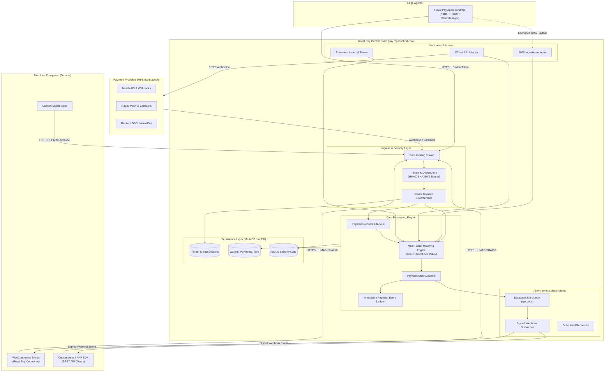
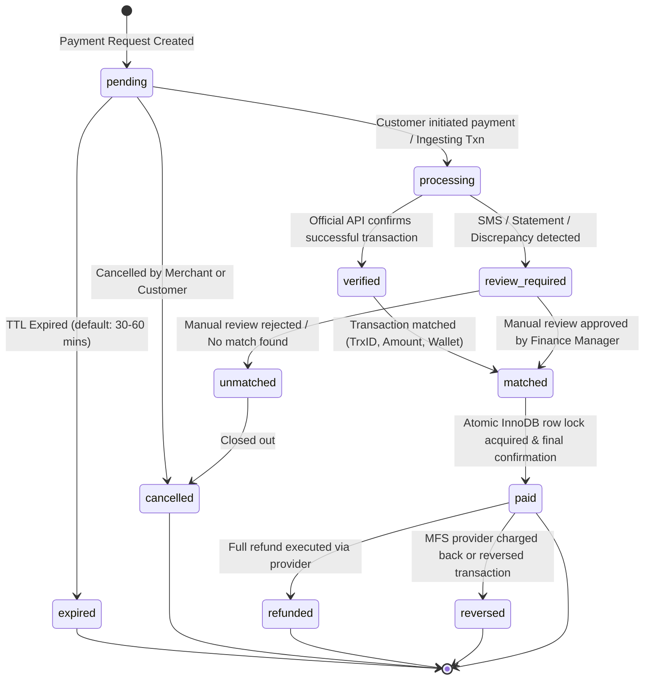

# Royal Pay Automation SaaS — System Architecture Specification

## 1. System Overview & Topology

Royal Pay Automation is designed as a centralized, multi-tenant SaaS payment automation and reconciliation platform. It decouples high-risk financial transaction verification from edge merchant websites, acting as an immutable ledger and intelligent matching engine.



---

## 2. Component Dependency Map

The SaaS platform is structured into strictly decoupled modules following Clean Architecture and SOLID design principles:

```mermaid
graph TD
    subgraph Presentation["Presentation & Ingress Layer"]
        RestControllers["REST API Controllers (v1)"]
        AdminDashboard["WordPress WP-Admin Dashboard"]
        WebhookReceivers["Provider Webhook Handlers"]
    end

    subgraph Middleware["Isolation & Security Middleware"]
        TenantResolver["Tenant Resolution Middleware"]
        HMACValidator["HMAC-SHA256 & Nonce Validator"]
        RBACGuard["Role-Based Access Control"]
        RateLimiter["Rate Limiting & Abuse Prevention"]
    end

    subgraph DomainCore["Domain & Application Core"]
        TenantService["Tenant & Site Management"]
        WalletService["Wallet & Provider Credential Vault"]
        PaymentService["Payment Request Lifecycle"]
        MatchingEngine["Payment Matching Engine"]
        StateMachine["Payment State Machine"]
        JobQueue["Async Job Queue Engine"]
        WebhookDispatcher["Webhook Dispatcher"]
    end

    subgraph ProviderAdapters["Payment Provider Abstraction Layer"]
        ProviderInterface["ProviderInterface"]
        BkashAdapter["BkashProvider (Tokenized API)"]
        NagadAdapter["NagadProvider (PGW Callback)"]
        RocketAdapter["RocketProvider (NexusPay / Fallback)"]
    end

    subgraph Persistence["Persistence & Infrastructure"]
        DB["MariaDB (InnoDB Engine)"]
        Encrypter["AES-256-GCM Secret Encrypter"]
        AuditLogger["Audit & Security Logger"]
    end

    RestControllers --> TenantResolver
    AdminDashboard --> RBACGuard
    WebhookReceivers --> TenantResolver

    TenantResolver --> HMACValidator
    HMACValidator --> TenantService

    TenantService --> WalletService
    PaymentService --> WalletService
    PaymentService --> MatchingEngine
    MatchingEngine --> StateMachine
    MatchingEngine --> ProviderInterface
    ProviderInterface <|-- BkashAdapter
    ProviderInterface <|-- NagadAdapter
    ProviderInterface <|-- RocketAdapter

    StateMachine --> LedgerRepo["Payment Event Ledger Repository"]
    StateMachine --> JobQueue
    JobQueue --> WebhookDispatcher

    DomainCore --> DB
    DomainCore --> Encrypter
    DomainCore --> AuditLogger
```

---

## 3. Tenant Isolation Model

Every merchant is provisioned as an independent tenant entity with complete horizontal and vertical data isolation:

### Isolation Architecture
1. **Tenant Identity Resolution**:
   - For merchant API calls: resolved strictly from the authenticated API Key (`X-RoyalPay-Key`) via database hash lookup. Unauthenticated `tenant_id` parameters in request bodies or query strings are ignored and discarded.
   - For Android Agent calls: resolved strictly from the authenticated Device Token (`X-Device-Token`) bound to a specific tenant device record.
   - For Admin users: resolved from the authenticated WordPress user context (`wp_get_current_user()`) via the `rpa_user_roles` association table.
2. **Repository-Level Scoping**:
   - Every database query for tenant-owned tables (`rpa_wallets`, `rpa_payment_requests`, `rpa_transactions`, `rpa_webhook_endpoints`, etc.) enforces `tenant_id = %d` in all `WHERE` clauses.
   - Cross-tenant queries are blocked at the repository layer.
3. **Multi-Tenant Roles**:
   - `super_admin`: Global platform operator. Can view system health, manage subscription plans, and inspect global logs.
   - `saas_support`: Read-only troubleshooting across tenants, prohibited from viewing private provider credentials or API secrets.
   - `tenant_owner`: Complete authority over tenant resources (Billing, API Keys, Wallets, Devices, Users).
   - `tenant_admin`: Operational management (Sites, Wallets, Webhooks, Reconciliation).
   - `finance_manager`: Transactions, Statements, Refunds, Manual Review.
   - `developer`: API Keys, Webhook logs, Device logs, Documentation.
   - `read_only`: Viewing transactions and payment statuses.

---

## 4. Payment State Machine

The payment lifecycle transitions through an immutable, strictly validated state machine. Every transition creates an append-only audit event in `rpa_payment_events`.



### Transition Integrity Rules:
1. `paid` state can **only** be reached when:
   - Official API confirmed successful transaction **OR** Manual Review was approved by authorized staff.
   - Transaction ID is unique across the entire platform database (`rpa_transactions.transaction_id`).
   - Receiver wallet belongs to the tenant.
   - Amount in minor units matches exactly (`amount_minor == expected_amount_minor`).
   - Currency is `BDT`.
   - Payment request is in `pending`, `processing`, `verified`, or `review_required` state.
2. A payment in `paid` state can never transition back to `pending` or `processing`.
3. Simultaneous matching attempts on the same payment request or transaction ID are serialized using `SELECT ... FOR UPDATE` database row locks.

---

## 5. Background Job Queue Subsystem

To avoid blocking web requests and ensure resilient asynchronous execution without relying solely on web-traffic-triggered WP-Cron:

1. **Job Table (`rpa_jobs`)**:
   - Stores queued tasks: `webhook_delivery`, `provider_verify`, `statement_process`, `device_heartbeat_check`, `expired_payment_cleanup`.
   - Fields: `id`, `tenant_id`, `queue`, `payload`, `attempts`, `max_attempts`, `available_at`, `status` (`pending`, `reserved`, `failed`, `completed`), `created_at`.
2. **Worker Runner**:
   - Executable via System CLI cron: `php royal-pay-queue-worker.php` running every minute, or WP-CLI command `wp royal-pay queue:work`.
   - Locks jobs using `UPDATE rpa_jobs SET status = 'reserved' WHERE ... LIMIT 1` with a reservation timeout.
3. **Exponential Backoff & Dead-Letter Queue**:
   - Failed webhook deliveries retry at: 1 min, 5 mins, 15 mins, 1 hour, 6 hours.
   - After 5 attempts, marked as `failed` (Dead-letter status) and triggers an alert for manual inspection in the Tenant Dashboard.

---

## 6. Technical Decisions & Assumptions Log

| Component | Technical Decision | Rationale |
|:---|:---|:---|
| **Currency Storage** | Integer Minor Units (`BIGINT` or `INT`) | 1 BDT = 100 Paisa (1500 BDT = 150000). Completely eliminates IEEE-754 floating point rounding bugs. |
| **Provider API Fallback** | Disabled/Pending state if no live credentials | Prevents fabrication of credentials; ensures test and production environments are strictly separated. |
| **SMS Trust Level** | SMS Ingestion = `review_required` by default | SMS headers can be spoofed on unrooted or tampered devices. Cryptographic proof requires official API confirmation. |
| **WooCommerce Storage** | High-Performance Order Storage (HPOS) & Legacy CRUD | Uses `\WC_Order` CRUD APIs. Never runs direct SQL on `wp_posts` or `wp_wc_orders`. |
| **Encryption** | AES-256-GCM | Secure hardware/software encryption for provider API secrets, credentials, and webhook signing secrets. |
| **Idempotency** | Composite Unique Key `(tenant_id, idempotency_key)` | Guarantees identical retry requests return cached results without creating duplicate payments. |
