# Royal Pay Database Architecture & Schema Specification

## 1. Database Standards & Engine Guidelines

- **Database Engine**: MariaDB 10.11+ / MySQL 8.0+ with **InnoDB** storage engine for all tables.
- **Character Set & Collation**: `utf8mb4` with `utf8mb4_unicode_ci` (full emoji and international character support).
- **Prefix Strategy**: Dynamic WordPress prefix `$wpdb->prefix . 'rpa_'` (e.g., `wp_rpa_tenants`). Never hardcoded.
- **Monetary Representation**: Integer Minor Units stored as `BIGINT(20)`. (1 BDT = 100 Paisa; 1,500 BDT is stored as `150000`). No floating-point data types (`FLOAT`, `DOUBLE`) are permitted for financial fields.
- **Timestamps**: All timestamps stored in UTC (`DATETIME` or `TIMESTAMP`).
- **UUIDs**: All public external references (`uuid`, `payment_reference`, `event_id`) use UUID v4 or cryptographically secure alphanumeric strings.
- **Tenant Scoping**: All tenant-owned records have `tenant_id BIGINT(20) UNSIGNED NOT NULL` with foreign key and index constraints.

---

## 2. Complete Entity-Relationship (ER) Diagram

```mermaid
erDiagram
    rpa_tenants ||--o{ rpa_tenant_sites : owns
    rpa_tenants ||--o{ rpa_users : has
    rpa_tenants ||--o{ rpa_wallets : configures
    rpa_tenants ||--o{ rpa_devices : registers
    rpa_tenants ||--o{ rpa_api_keys : generates
    rpa_tenants ||--o{ rpa_webhook_endpoints : registers
    rpa_tenants ||--o{ rpa_payment_requests : accepts
    rpa_tenants ||--o{ rpa_transactions : receives
    rpa_tenants ||--o{ rpa_audit_logs : logs
    rpa_tenants ||--o{ rpa_statement_imports : imports
    rpa_tenants ||--o{ rpa_subscriptions : subscribes

    rpa_plans ||--o{ rpa_subscriptions : defines

    rpa_wallets ||--o{ rpa_payment_requests : assigned_to
    rpa_wallets ||--o{ rpa_transactions : receives_on
    rpa_wallets ||--o{ rpa_device_wallets : mapped_to

    rpa_devices ||--o{ rpa_device_wallets : monitors
    rpa_devices ||--o{ rpa_device_events : emits
    rpa_devices ||--o{ rpa_sms_logs : ingests

    rpa_payment_requests ||--o{ rpa_payment_matches : matched_with
    rpa_transactions ||--o{ rpa_payment_matches : settles
    rpa_payment_requests ||--o{ rpa_payment_events : records
    rpa_payment_requests ||--o{ rpa_refunds : generates

    rpa_webhook_endpoints ||--o{ rpa_webhook_events : dispatches
    rpa_webhook_events ||--o{ rpa_webhook_deliveries : attempts

    rpa_statement_imports ||--o{ rpa_statement_rows : contains
    rpa_statement_imports ||--o{ rpa_reconciliation_batches : reconciles

    rpa_tenants {
        BIGINT id PK
        VARCHAR uuid UK
        VARCHAR business_name
        VARCHAR trade_license
        VARCHAR contact_email
        VARCHAR contact_phone
        ENUM status "active, suspended, pending"
        DATETIME created_at
        DATETIME updated_at
    }

    rpa_tenant_sites {
        BIGINT id PK
        BIGINT tenant_id FK
        VARCHAR site_url
        VARCHAR site_name
        VARCHAR platform "woocommerce, custom_php, other"
        VARCHAR webhook_secret
        ENUM status "active, inactive, revoked"
        DATETIME created_at
    }

    rpa_users {
        BIGINT id PK
        BIGINT tenant_id FK
        BIGINT wp_user_id FK
        VARCHAR role "tenant_owner, tenant_admin, finance_manager, developer, read_only"
        ENUM status "active, inactive"
        DATETIME created_at
    }

    rpa_wallets {
        BIGINT id PK
        BIGINT tenant_id FK
        ENUM provider "bkash, nagad, rocket"
        VARCHAR account_number
        ENUM account_type "merchant, personal, agent"
        TEXT encrypted_credentials
        ENUM status "active, disabled, pending_verification"
        BIGINT daily_limit_minor
        BIGINT monthly_limit_minor
        DATETIME created_at
    }

    rpa_devices {
        BIGINT id PK
        BIGINT tenant_id FK
        VARCHAR device_uuid UK
        VARCHAR device_name
        VARCHAR model
        VARCHAR android_version
        VARCHAR app_version
        VARCHAR token_hash UK
        DATETIME last_heartbeat_at
        ENUM status "active, suspended, revoked"
        DATETIME created_at
    }

    rpa_payment_requests {
        BIGINT id PK
        BIGINT tenant_id FK
        BIGINT site_id FK
        BIGINT wallet_id FK
        VARCHAR payment_uuid UK
        VARCHAR payment_reference UK
        VARCHAR external_order_id
        BIGINT amount_minor
        VARCHAR currency "BDT"
        ENUM provider "bkash, nagad, rocket, any"
        ENUM status "pending, processing, verified, matched, paid, failed, expired, cancelled, refunded"
        DATETIME expires_at
        DATETIME paid_at
        DATETIME created_at
    }

    rpa_transactions {
        BIGINT id PK
        BIGINT tenant_id FK
        BIGINT wallet_id FK
        ENUM provider "bkash, nagad, rocket"
        VARCHAR transaction_id UK
        BIGINT amount_minor
        VARCHAR currency "BDT"
        VARCHAR sender_number
        VARCHAR reference
        ENUM verification_source "official_api, webhook, android_sms, statement_import, manual_entry"
        ENUM status "unmatched, matched, duplicate, review_required, reversed"
        DATETIME transaction_time
        DATETIME created_at
    }

    rpa_payment_matches {
        BIGINT id PK
        BIGINT tenant_id FK
        BIGINT payment_request_id FK, UK
        BIGINT transaction_id FK, UK
        ENUM match_rule "exact_reference_trxid, exact_trxid, manual_approval"
        BIGINT matched_by_user_id
        DATETIME matched_at
    }

    rpa_payment_events {
        BIGINT id PK
        BIGINT payment_request_id FK
        VARCHAR from_status
        VARCHAR to_status
        VARCHAR reason
        JSON metadata
        DATETIME created_at
    }

    rpa_api_keys {
        BIGINT id PK
        BIGINT tenant_id FK
        VARCHAR name
        VARCHAR key_prefix
        VARCHAR key_hash UK
        VARCHAR secret_hash
        JSON scopes
        DATETIME expires_at
        DATETIME revoked_at
        DATETIME last_used_at
        DATETIME created_at
    }

    rpa_idempotency_keys {
        BIGINT id PK
        BIGINT tenant_id FK
        VARCHAR idempotency_key
        VARCHAR request_hash
        INT response_code
        LONGTEXT response_body
        DATETIME created_at
    }

    rpa_webhook_endpoints {
        BIGINT id PK
        BIGINT tenant_id FK
        VARCHAR target_url
        VARCHAR secret
        JSON events
        ENUM status "active, disabled"
        DATETIME created_at
    }

    rpa_webhook_events {
        BIGINT id PK
        BIGINT tenant_id FK
        VARCHAR event_id UK
        VARCHAR event_type
        BIGINT payment_id FK
        LONGTEXT payload
        ENUM status "pending, processing, delivered, failed"
        DATETIME created_at
    }

    rpa_webhook_deliveries {
        BIGINT id PK
        BIGINT webhook_event_id FK
        BIGINT endpoint_id FK
        INT attempt_number
        INT response_code
        TEXT response_body
        INT execution_time_ms
        DATETIME attempted_at
    }

    rpa_audit_logs {
        BIGINT id PK
        BIGINT tenant_id FK
        BIGINT user_id
        VARCHAR action
        VARCHAR entity_type
        BIGINT entity_id
        VARCHAR ip_address
        VARCHAR user_agent
        JSON changes
        DATETIME created_at
    }
```

---

## 3. Database Tables Breakdown (28 Tables)

### Group A: Multi-Tenant & Identity Tables
1. **`rpa_tenants`**: Primary merchant account container.
2. **`rpa_tenant_sites`**: Merchant e-commerce stores (WooCommerce, custom sites).
3. **`rpa_users`**: Tenant user membership linking WordPress `users` to tenant roles.
4. **`rpa_roles`**: System roles (`super_admin`, `tenant_owner`, `tenant_admin`, `finance_manager`, `developer`, `read_only`).
5. **`rpa_permissions`**: Fine-grained capabilities (e.g., `payments:approve`, `wallets:manage`, `keys:generate`).
6. **`rpa_user_roles`**: Pivot table binding users, tenants, and roles.

### Group B: SaaS Subscription & Billing
7. **`rpa_plans`**: Subscription packages (Free Trial, Starter, Business, Enterprise) with quotas.
8. **`rpa_subscriptions`**: Active tenant subscription subscriptions, billing periods, and status.
9. **`rpa_usage_counters`**: Real-time monthly usage counters (payment counts, SMS sync counts, active devices).
10. **`rpa_billing_events`**: Immutable audit logs of plan upgrades, downgrades, renewals, and invoice receipts.

### Group C: Wallets & Providers
11. **`rpa_wallets`**: Tenant MFS accounts (bKash Merchant, Nagad Uddokta, Rocket Agent/Merchant).
12. **`rpa_provider_accounts`**: Official API connection configurations and encrypted credentials.
13. **`rpa_wallet_verifications`**: OTP, balance, and activation check logs.

### Group D: Edge Devices & SMS
14. **`rpa_devices`**: Registered Android hardware running Royal Pay Agent.
15. **`rpa_device_wallets`**: Mapping of SIM slots and wallet numbers monitored by a specific device.
16. **`rpa_device_events`**: Battery levels, network transitions, app starts, heartbeat checks.
17. **`rpa_sms_logs`**: Raw SMS headers, sender hash, and processing audit records.
18. **`rpa_sms_parser_rules`**: Versioned regex and parsing rules for bKash, Nagad, and Rocket SMS formats.

### Group E: Payments & Transactions
19. **`rpa_payment_requests`**: Checkout payment requests initiated by merchant stores.
20. **`rpa_transactions`**: Ingested financial records from Official APIs, SMS, and Statements.
21. **`rpa_payment_matches`**: 1-to-1 atomic link between a payment request and a transaction. Unique constraints on both IDs prevent double-spending.
22. **`rpa_payment_events`**: Immutable event trail recording every state transition.
23. **`rpa_refunds`**: Provider-initiated or merchant-initiated refunds with original transaction references.

### Group F: Statements & Reconciliation
24. **`rpa_statement_imports`**: Metadata and SHA-256 hash of uploaded CSV/XLSX bank statements.
25. **`rpa_statement_rows`**: Raw and normalized parsed statement lines.
26. **`rpa_reconciliation_batches`**: Reconciliation run batches, discrepancies, and match counts.

### Group G: API, Webhooks, Jobs & Security
27. **`rpa_api_keys`**: API credentials with prefix, hash, and scoped permissions.
28. **`rpa_api_logs`**: API request tracking, execution timing, and response status.
29. **`rpa_idempotency_keys`**: Request deduplication store with cached responses.
30. **`rpa_webhook_endpoints`**: Merchant destination URLs and signing secrets.
31. **`rpa_webhook_events`**: Outbound event payloads.
32. **`rpa_webhook_deliveries`**: Delivery attempts, HTTP response codes, and latency.
33. **`rpa_audit_logs`**: Tamper-evident administrative audit trail.
34. **`rpa_login_attempts`**: Brute-force protection tracking.
35. **`rpa_security_events`**: Security alerts (signature failures, replay attacks, cross-tenant attempts).
36. **`rpa_jobs`**: Resilient background job queue.
