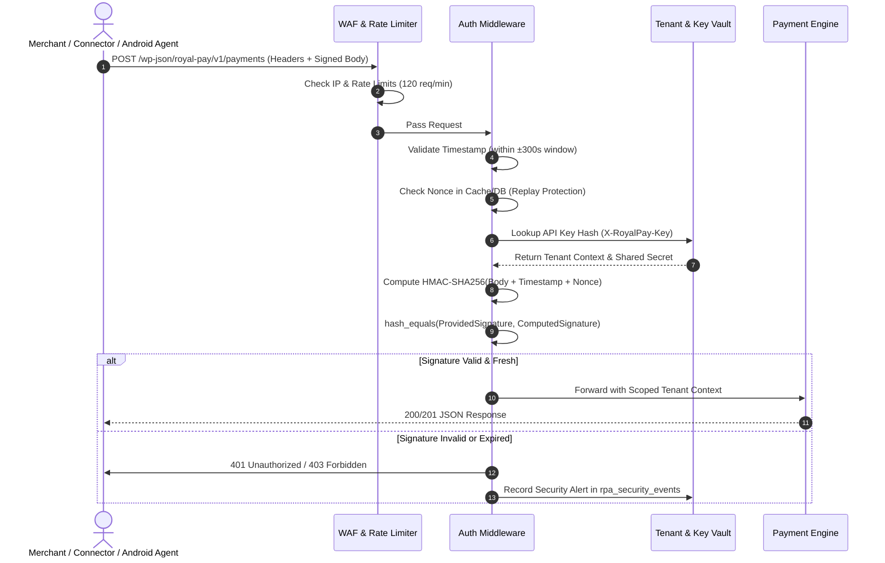

# Royal Pay Security Threat Model & Cryptographic Specification

## 1. Authentication & Integrity Architecture

Royal Pay implements zero-trust cryptographic verification across all ingress boundaries:



---

## 2. Cryptographic Specifications

### A. HMAC-SHA256 Request Signing
Every authenticated HTTP request from merchant connectors and SDKs must transmit the following headers:
- `X-RoyalPay-Key`: Public API key identifier (e.g. `rpa_live_abc123...`).
- `X-RoyalPay-Timestamp`: Current UTC UNIX timestamp in seconds or ISO-8601 string. Must be within **300 seconds** (5 minutes) of server time to prevent replay attacks.
- `X-RoyalPay-Nonce`: Cryptographically secure random UUID or string (minimum 16 bytes). Must not have been seen within the timestamp validity window.
- `X-RoyalPay-Signature`: `hash_hmac('sha256', $payload_to_sign, $secret_key)` where:
  ```
  $payload_to_sign = $http_method . "\n" . 
                     $request_path . "\n" . 
                     $timestamp . "\n" . 
                     $nonce . "\n" . 
                     hash('sha256', $raw_request_body);
  ```
All signature comparisons on the server use PHP's constant-time function `hash_equals()` to prevent timing attacks.

### B. Credential Vault Encryption (AES-256-GCM)
All sensitive credentials—including MFS API passwords, private RSA keys, and webhook signing secrets—are encrypted at rest in the database using **AES-256-GCM** (Galois/Counter Mode) with authenticated integrity tags:
- Encryption key derived from `ROYAL_PAY_ENCRYPTION_KEY` constant in `wp-config.php`.
- Each record receives a unique, cryptographically random 12-byte Initialization Vector (IV).
- The 16-byte authentication tag guarantees detection of any database tampering.

---

## 3. STRIDE Threat Model & Mitigations

| Threat Category | Potential Attack Vector | Royal Pay Countermeasure & Mitigation |
|:---|:---|:---|
| **Spoofing** | Attacker impersonates a merchant website or Android device. | Public key / token hashing, strict HMAC-SHA256 signatures, Android Keystore token binding. |
| **Tampering** | Attacker alters payment amount or order reference in transit. | HTTPS mandatory (TLS 1.2+); HMAC signature covers full SHA-256 body hash. Any altered byte causes signature verification failure. |
| **Repudiation** | Merchant claims they did not initiate a payment request; employee disputes manual approval. | Immutable audit log in `rpa_audit_logs` and `rpa_payment_events` with IP, timestamp, user ID, and state transition diff. |
| **Information Disclosure** | Cross-tenant data leakage; API keys or MFS credentials leaked in logs. | Mandatory tenant-scoping in SQL queries; AES-256-GCM encryption at rest; automatic redaction of `password`, `secret`, `token`, `pin` keys in all loggers. |
| **Denial of Service** | High-volume payment creation spam; webhook flood. | Redis/transient-backed rate limiting (per-IP and per-tenant); background asynchronous queue processing (`rpa_jobs`) so webhooks do not block web workers. |
| **Elevation of Privilege** | Tenant user attempts to access Super Admin dashboard or another tenant's wallet. | Strict Role-Based Access Control (RBAC) enforced in middleware; non-super-admins restricted to their resolved `tenant_id`. |

---

## 4. Double-Spending & Race Condition Protection

To prevent concurrent transactions or duplicate webhooks from claiming the same payment request:
1. **Atomic InnoDB Row Locking**:
   When matching a transaction, the matching service initiates a database transaction and executes:
   ```sql
   SELECT * FROM wp_rpa_payment_requests WHERE id = %d AND status IN ('pending', 'processing', 'verified') FOR UPDATE;
   ```
2. **Database Unique Constraints**:
   - `rpa_transactions.transaction_id`: `UNIQUE KEY uq_provider_trxid (provider, transaction_id)` ensures a transaction ID can only be saved once.
   - `rpa_payment_matches.payment_request_id`: `UNIQUE KEY uq_payment_request_id (payment_request_id)` ensures a payment request can only ever be matched with one transaction.
   - `rpa_payment_matches.transaction_id`: `UNIQUE KEY uq_transaction_id (transaction_id)` ensures a single transaction can never pay multiple orders.
3. **Idempotency Keys**:
   The header `Idempotency-Key` is supported on all `POST /payments` requests. Re-transmissions within 24 hours return the identical cached JSON response without executing duplicate database inserts.
